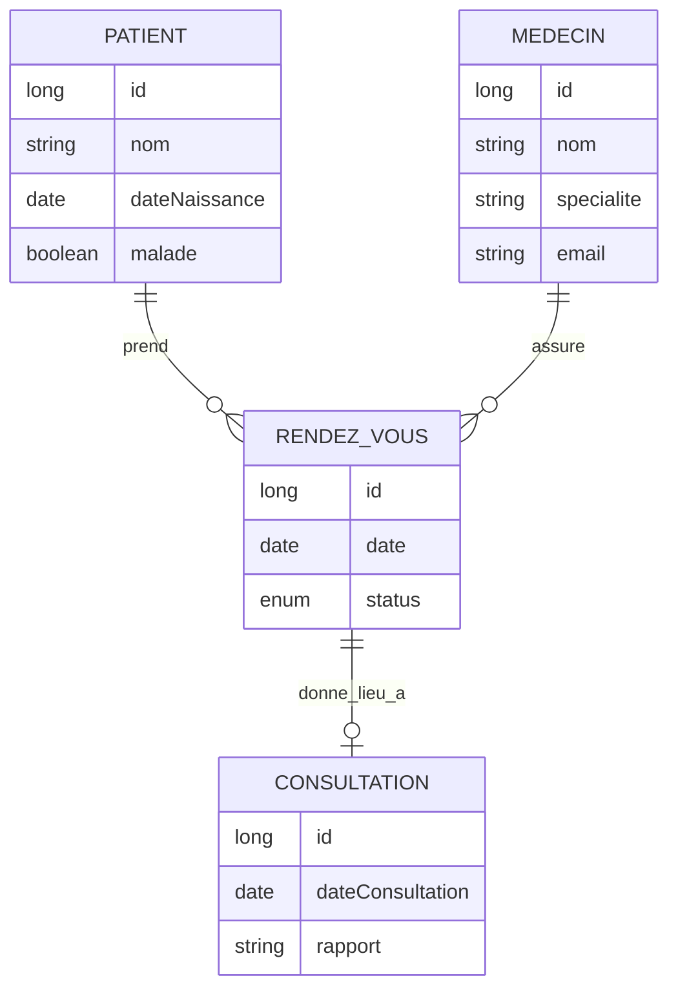

# 🏥 Hospital — Spring Boot & Spring Data JPA

**Modélisation d'un système de gestion hospitalière avec JPA / Hibernate : patients, médecins, rendez-vous et consultations.**


Travail pratique du module **Java / Spring** — Génie informatique, Université Mundiapolis.

---

## 🗂️ Modèle de données



| Relation | Annotation JPA |
|---|---|
| Patient → Rendez-vous | `@OneToMany(mappedBy = "patient")` |
| Médecin → Rendez-vous | `@OneToMany(mappedBy = "medcin")` |
| Rendez-vous → Consultation | `@OneToOne` |
| Statut du rendez-vous | `enum StatusRDV` |

## ⚙️ Ce que fait l'application

Au démarrage, un `CommandLineRunner` utilise les repositories Spring Data pour :

1. enregistrer trois patients et trois médecins,
2. les retrouver avec des requêtes dérivées (`findByNom`),
3. créer un rendez-vous (statut `Pending`) entre un patient et un médecin,
4. enregistrer la consultation associée.

Une couche service (`IHospitalService` / `HospitalService`) expose aussi ces opérations d'enregistrement.

Les données peuvent ensuite être consultées dans la console H2.

## 🚀 Lancer le projet

```bash
./mvnw spring-boot:run
```

Console H2 : http://localhost:8036/h2-console (JDBC URL : `jdbc:h2:mem:hospotal`)

## 📁 Structure

```
src/main/java/com/example/hopital/
├── entities/        # Patient, Medcin, RendezVous, Consultation, StatusRDV
├── repositories/    # Interfaces Spring Data JPA
├── IHospitalService.java
├── HospitalService.java
└── HospitalApplication.java
```

---

👤 **Saad Sabir Idrissi** — Élève ingénieur Data & IA · [Portfolio](https://saad-sabir-idrissi.vercel.app) · [LinkedIn](https://www.linkedin.com/in/saad-sabir-idrissi)
